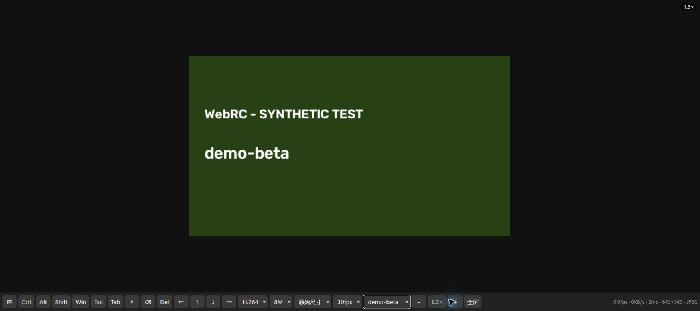

# WebRC — 面向 Windows 的自托管浏览器远程桌面

[English](README.md)

WebRC 让你用浏览器查看并控制一台已授权的 Windows 电脑。被控端的 agent 只向你自己运行的中继发起一条出站 WebSocket 连接，浏览器再连接这个中继。agent 不监听入站端口。

[本地体验](#本地快速体验) · [部署中继](#仅安装-relay) · [参与贡献](CONTRIBUTING.md)



*模拟画面经实际中继与浏览器渲染，仅用于展示界面，不是实机远控或性能证明。*

## 核心能力

- **agent 仅出站** — `agent.py` 主动连接你的 relay，不在被控端打开监听端口。
- **多电脑切换** — 多个 agent 可连接同一个 relay，页面工具栏可选择目标电脑；切换电脑时浏览器 WebSocket 不重连。
- **移动触控与输入法** — 支持触屏手势、软键盘输入和浏览器提供的 composition/IME 文本输入。
- **显示器选择** — 可选择单个显示器，也可选择合并的虚拟桌面（`--monitor 0`）；页面可在连接中切换显示器。
- **JPEG 与可选 H.264** — JPEG 发送变化条带，是兼容性优先路径。H.264 为可选能力，依赖 ffmpeg 和浏览器 `VideoDecoder`，可用性在运行时探测。
- **回执背压** — agent 等待帧回执，慢速观看端不会无限堆积旧帧。
- **无人观看时暂停** — 页面在后台持续 10 秒后断开观看连接，没有活跃观看者时 agent 停止采集。

## 架构

```text
Windows 电脑 A  agent.py ── 出站 WSS ─┐
Windows 电脑 B  agent.py ── 出站 WSS ─┤→ relay.py ── WSS ─→ 浏览器观看端
                                    └← 输入事件 ←── 浏览器观看端
```

- agent 采集交互式 Windows 桌面，编码后发给 relay。
- relay 转发帧和控制消息，不解码视频。
- 观看端解码 JPEG 或 H.264，并把鼠标、键盘、触控和设置消息经 relay 发回。
- 共享 token 由 relay 同时校验 agent 与观看端连接。

## 环境要求

- **被控端 agent：** Windows，需要已登录的交互式桌面和 Python 3.11+。基础依赖为 `aiohttp`、`mss`、`numpy`、`opencv-python-headless`、`pynput`；可从 [requirements.txt](requirements.txt) 安装。
- **可选 agent 依赖：** `dxcam` 可选并从 [requirements-optional.txt](requirements-optional.txt) 单独安装；不可用时自动回退 `mss`。`--monitor 0` 使用 `mss`。ffmpeg 是单独的可选可执行文件，仅 H.264 需要。
- **relay：** Python 3.11+；源码除标准库外仅导入 `aiohttp`，可从 [requirements-relay.txt](requirements-relay.txt) 安装。其他中继操作系统仍需验证。
- **观看端：** 需要支持 WebSocket 与 canvas 的浏览器。JPEG 是兼容性优先编码。H.264 需要安全上下文、浏览器 `VideoDecoder` 支持，以及 agent 侧可用的 ffmpeg 编码器。

## 本地快速体验

此预览只把 relay 绑定到回环地址，使用 JPEG 与 `mss`，示例 token 仅供本次本地体验。

> **安全提示：** `--dry-run` 仍会采集并传输桌面画面，只是把输入事件写入日志而不注入。不要在敏感内容可见时运行这个预览。

1. 下载或克隆仓库，在仓库根目录打开两个 PowerShell 终端。
2. 在终端 1 创建虚拟环境并安装 agent 依赖：

```powershell
python -m venv .venv
.\.venv\Scripts\python.exe -m pip install -r requirements.txt
```

3. 在终端 1 启动 relay：

```powershell
.\.venv\Scripts\python.exe relay.py --host 127.0.0.1 --port 18765 --token local-demo-only-change-me
```

4. 在终端 2 启动 agent：

```powershell
.\.venv\Scripts\python.exe agent.py --relay ws://127.0.0.1:18765 --token local-demo-only-change-me --codec jpeg --capture mss --dry-run
```

5. 打开：

```text
http://127.0.0.1:18765/?token=local-demo-only-change-me
```

这个示例 token 只用于回环预览，绝不可用于部署后的 relay。本次 agent 不初始化 H.264 编码器，所以即使页面请求 H.264，仍使用 JPEG。以后要体验 H.264，请先安装 ffmpeg，再移除 `--codec jpeg` 重启 agent。

## 仅安装 relay

relay 可以独立部署，不必与 agent 同机。

1. 将 `relay.py`、`index.html` 和 `requirements-relay.txt` 复制到 relay 主机。
2. 使用独立虚拟环境安装：

```powershell
python -m venv .venv
.\.venv\Scripts\python.exe -m pip install -r requirements-relay.txt
```

3. 按下节准备证书并启动 relay，在主机防火墙和云/网络安全层放行所选 TCP 端口。
4. 若省略 `--token`，relay 会生成或沿用 `relay.py` 同目录的 `relay.token`。在该主机的另一个终端本机读取：

```powershell
(Get-Content -LiteralPath .\relay.token -Raw).Trim()
```

请保密这个值，并让每个授权 agent 与观看端使用同一个值。启动日志不输出 token。已有 token 文件为空时会报错；请先停止 relay、删除空文件，再启动生成新 token。

## TLS 部署

除回环快速体验外，请使用 HTTPS/WSS。优先使用浏览器信任的证书。若使用私有 CA 或自签证书，应先在带外核对指纹，再给 relay 配置 `--cert` 与 `--key`，给 agent 配置 `--cafile`。

如果已安装 OpenSSL，下面的 PowerShell 示例会在已被 gitignore 的 `certs` 目录生成私有测试证书和私钥。请把示例 DNS 和 IP 替换为中继的真实值：

```powershell
New-Item -ItemType Directory -Force -Path .\certs
openssl req -x509 -newkey rsa:2048 -nodes -days 365 -keyout .\certs\relay.key -out .\certs\relay.crt -subj "/CN=relay.example.invalid" -addext "subjectAltName=DNS:relay.example.invalid,IP:203.0.113.10"
```

带证书启动 relay：

```powershell
.\.venv\Scripts\python.exe relay.py --host 0.0.0.0 --port 33445 --cert .\certs\relay.crt --key .\certs\relay.key
```

使用私有证书时，先核对指纹，再在浏览器或系统中配置信任。只把公开证书或 CA 证书复制到 agent，私钥留在中继。保持证书校验，不忽略浏览器警告，也不使用 `--insecure`。

## 部署 agent

在已授权的 Windows 电脑上：

```powershell
python -m venv .venv
.\.venv\Scripts\python.exe -m pip install -r requirements.txt
```

可选安装 `dxcam`：

```powershell
.\.venv\Scripts\python.exe -m pip install -r requirements-optional.txt
```

如需 H.264，另行安装 ffmpeg 并确保其在 `PATH` 中。把已核对的公开中继证书复制到 agent 的 `certs/relay.crt`，然后连接（将示例主机名换为你的中继）：

```powershell
$relayToken = Read-Host 'Relay token'
.\.venv\Scripts\python.exe agent.py --relay wss://relay.example.invalid:33445 --token $relayToken --cafile .\certs\relay.crt --name home-pc
```

观看端打开 `https://relay.example.invalid:33445/?token=YOUR_TOKEN`，将主机名和 `YOUR_TOKEN` 换为自己的值。添加其他电脑时给 agent 使用不同的 `--name`；同名连接会替换之前的连接。

默认请以标准用户运行 agent。标准用户 agent 因 Windows UIPI 无法控制提权窗口。以管理员运行会扩大可控范围，也会扩大被攻陷后的影响面；即便如此，它仍不能采集或控制安全桌面、UAC 提示或锁屏。只控制你已获授权的设备。

## 操作方式

| 动作 | 桌面 | 触控 |
|---|---|---|
| 左键 / 双击 | 点击 / 双击 | 单击 / 双击 |
| 右键 | 右键 | 双指点按，或长按后松开 |
| 拖动 | 按住拖动 | 长按后拖动 |
| 滚动 | 滚轮或触控板 | 双指拖动 |
| 缩放 | 捏合或工具栏 `−` / `+` | 捏合；双指连击切换缩放 |
| 放大后平移 | 鼠标移到画面边缘 | 单指拖动 |
| 输入 | 键盘，含输入法 | 软键盘；composition 文本会发送 |
| 修饰键 | 按住 `Ctrl` / `Alt` / `Shift` / `Win` | 先点亮工具栏修饰键再操作 |
| 全屏 | 工具栏按钮或浏览器全屏 | 支持处使用工具栏按钮 |

状态栏显示实测帧率、吞吐、往返时间、分辨率和编码。这是诊断信息，不是性能承诺。

当前工具栏主要使用中文。全屏下能否拦截系统快捷键取决于浏览器支持；长按 `Esc` 可退出全屏。

## 参数

`agent.py`：

- `--relay`、`--token`、`--name`
- `--cafile`、`--insecure`（部署时不要使用 `--insecure`）
- `--monitor` — `1`、`2`、…，`0` 表示合并虚拟桌面
- `--codec auto|h264|jpeg` — 初始编码
- `--encoder auto|qsv|nvenc|amf|x264`
- `--ffmpeg PATH`
- `--capture auto|dxcam|mss`
- `--width`、`--quality`、`--fps`、`--kbps`
- `--dry-run`、`--log`

`relay.py`：

- `--host`、`--port`
- `--token`
- `--cert`、`--key`
- `--log`

观看端工具栏设置是运行时配置，可改变 agent 的初始编码和画质设置。

## 排障与限制

- **观看端无法连接** — 检查 relay 进程、token、TLS 证书、主机/端口和防火墙。
- **agent 无法连接** — 检查 relay URL、token 和 `--cafile`；证书错误表示 agent 不信任 relay 证书。
- **H.264 不可用或回退** — 浏览器需处于安全上下文并支持 `VideoDecoder`，agent 侧需有 ffmpeg 和可用编码器。
- **`--monitor 0` 使用 `mss`** — 这是预期行为；合并虚拟桌面采集路径不使用 `dxcam`。
- **锁屏、UAC 或安全桌面** — agent 运行在交互式会话中，无法采集或控制这些桌面。不要用关闭锁屏作为变通。
- **提权窗口无响应** — 标准用户 agent 无法向更高完整性级别的窗口注入输入。管理员运行会扩大控制范围和风险，仍不覆盖安全桌面。
- **一次传输一个采集范围** — WebRC 串流当前选择的显示器或合并虚拟桌面，没有声音、剪贴板或文件传输。
- **共享运行时设置** — 同一 agent 的观看者共享显示器和画质设置；最近的修改生效。

## 安全

WebRC 使用共享 token，没有按用户或电脑划分的权限。部署前请了解以下边界：

- token 是完整凭证。连接同一个 relay 的所有 agent 与观看端共享它。
- 受信任的 relay 可以读取屏幕截图和输入。配置 TLS 时保护的是逐跳传输；WebRC 没有端到端加密。
- agent 名称只是标签，不是授权。持有 token 的人可以伪造 agent 名称，或控制已连接的电脑。
- token 出现在观看端 URL 中，可能经浏览器历史、书签、代理日志和访问日志泄漏。运行日志可能包含敏感输入和窗口信息。

完整威胁模型和报告方式见 [SECURITY.md](SECURITY.md)。

## 贡献与测试

环境搭建和验证方式见 [CONTRIBUTING.md](CONTRIBUTING.md)。[发布检查单](docs/release-checklist.md) 记录了已完成的检查与公开发布前剩余工作。

## 许可证

[MIT](LICENSE)
